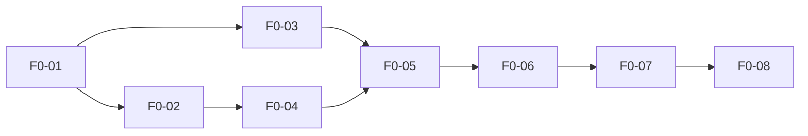

# F0 · Esqueleto andante

## Objetivo y entregable
Al terminar, desde la terminal se puede cargar un directorio de recursos (terrenos, objetos, mapas, criaturas), colocar criaturas en un mapa, correr N ticks con una semilla y ver el mapa en ASCII y un registro de eventos. También se puede comprobar un archivo `.ins` con un comando que reporta errores con su línea. Todo con piezas reales y con el diseño final (traits, catálogos, "el intérprete lee y el mundo escribe"), aunque el lenguaje sea un subconjunto.

## Estado de partida
- Repositorio nuevo. Solo existen `plan/MASTER.md` y esta carpeta.
- El enunciado es el archivo `instinct.md` que está fuera del repo; el primer issue lo copia a `docs/enunciado.md` para que las sesiones siguientes lo lean.
- Se asume Rust estable instalado en Windows y ninguna dependencia externa (sin internet): todos los comandos funcionan sin red.
- Todas las rutas de los issues son "nuevo" hasta que el issue que las crea se complete; cada issue cita lo que dejó el anterior.

## Contratos compartidos

**Estructura del repo** (nombres previstos; el implementador puede ajustar módulos internos, no estos nombres)

| Elemento | Contenido |
|---|---|
| `crates/instinct-core` | Biblioteca: lenguaje y mundo. Sin dependencias externas |
| `crates/instinct-cli` | Binario `instinct-cli`. Sin dependencias externas |
| `examples/` | Raíz de recursos de ejemplo con las carpetas `terrains/`, `objects/`, `maps/`, `creatures/` |
| `docs/` | `enunciado.md` y `ambiguedades.md` |

**Tipos que cruzan issues** (nombres exactos, en el núcleo)

| Tipo | Significado |
|---|---|
| `Diagnostic` | Archivo, línea (desde 1) y mensaje. Se muestra como `archivo:línea: mensaje` |
| `Value` | Entero de 64 bits con signo o texto |
| `Rng` | Generador propio con semilla; un solo generador por simulación |
| `World` | Rejilla, catálogo de terrenos y objetos, almacén de criaturas, contador de ticks, generador y lista de eventos |
| `Species` | Nombre, facción, vida, visión, esperanza de vida y (desde F0-06) el programa compilado |
| `Action` | Trait de las acciones: nombre, aridad, si consume turno, validación de argumentos y efecto sobre el mundo |
| `Perception` | Trait de las percepciones: nombre y lectura sobre una vista de solo lectura |
| `Catalog` | Registro de acciones y percepciones por nombre; añadir una es registrar un tipo nuevo |
| `Program` | Lista plana de líneas con su número de línea fuente y las etiquetas resueltas |
| `Simulation` | Mundo más reglas de turno; avanza un tick y devuelve los eventos |
| `Event` | Eventos del registro (ver tabla) |

**Semántica de `Value` y expresiones**

| Regla | Valor |
|---|---|
| División entera | Hacia menos infinito: 7 entre 2 da 3, -7 entre 2 da -4 |
| Resto | Con el signo del divisor: -7 resto 3 da 2, 7 resto -3 da -2 |
| División o resto por cero | Error de ejecución |
| Desbordamiento | Error de ejecución que nombra el desbordamiento |
| Comparaciones y lógica | Dan 1 o 0; `and` y `or` hacen cortocircuito de izquierda a derecha |
| Verdad | Falsos: el entero 0 y el texto vacío; todo lo demás verdadero |
| Texto | Solo `==` y `!=` entre textos; todo otro operador con texto es error de ejecución |
| Tipos distintos | Cualquier operador salvo `and`, `or`, `not` con tipos distintos es error de ejecución, incluido `==` |
| Precedencia (mayor a menor) | paréntesis; menos unario y `not`; `*` `/` `%`; `+` `-`; comparaciones (izquierda a derecha); `and`; `or` |
| Textos literales | Entre comillas dobles, sin secuencias de escape; un `#` dentro de comillas no inicia comentario |

**Formato de archivos de recursos**
- `.te`: claves `terrain`, `char`, `resource_max`, `regen`. `.ob`: claves `object`, `char`, `resource_max`. Una clave por línea con la forma clave y valor.
- En `.te`, `.ob` e `.ins` las líneas en blanco se ignoran. En `.te` y `.ob` solo es comentario la línea cuyo primer carácter no blanco es `#`; el valor de `char` es el resto de la línea sin espacios en los extremos y debe ser un único carácter (puede ser `#`).
- En `.ins` también hay comentarios al final de línea, salvo dentro de textos.
- `.map`: primera línea es el nombre; cada línea siguiente es una fila; no hay comentarios (el `#` es el carácter de la roca). Todas las filas con el mismo largo. Un carácter de objeto coloca ese objeto sobre el primer terreno cargado.
- Carga por orden terrenos, objetos, mapas, criaturas; dentro de cada carpeta, por nombre de archivo en orden alfabético. Un recurso que falla genera diagnósticos y la carga continúa con los demás. Una carpeta ausente se trata como vacía.

**Lenguaje en F0** (subconjunto de la sección 2 del enunciado)

| Forma de línea | Notas |
|---|---|
| Cabecera | `creature` primera línea no vacía; `faction`, `health`, `vision`, `lifespan` en cualquier orden; las cinco obligatorias, sin duplicados; `health` y `lifespan` mayores que 0, `vision` al menos 1 |
| Etiqueta, `goto`, `if` con `goto`, asignación, llamada a acción | `start:` obligatoria y separa cabecera de cuerpo |
| Acciones | `wait`, `move`, `say` |
| Percepciones | `health`, `age`, `lifespan`, `x`, `y`, `tick`, `random` |
| Funciones en expresiones | Ninguna aún: toda llamada en una expresión es error de compilación por función desconocida |

Los nombres de percepciones y acciones están reservados: asignarles es error de compilación, igual que a `if`, `goto`, `and`, `or`, `not`. Un nombre que no está en el catálogo es una variable; leerla antes de asignarla es error de ejecución. Los errores de ausencia (clave de cabecera o `start:`) se reportan en la línea 1. La compilación reporta todos los errores de un archivo, ordenados por línea. Los mensajes deben nombrar lo que falla (etiqueta, acción, clave).

**Turno de una criatura**

| Paso | Regla |
|---|---|
| Orden | En cada tick las criaturas vivas juegan en orden sorteado con el generador de la simulación |
| Dormida | Si le quedan turnos de sueño, se descuenta uno y no ejecuta nada |
| Ejecución | Desde su punto guardado (al nacer, `start:`). Etiquetas, `goto`, `if`, asignaciones y `say` no consumen turno |
| Fin de turno | Al ejecutarse una acción distinta de `say`. `wait` con n deja pasar n-1 turnos siguientes; n menor que 1 cuenta como 1 |
| Final del archivo | Termina el turno sin acción; el siguiente turno reanuda en `start:` |
| Límite | Como mucho 100 líneas ejecutadas por turno (cuentan etiquetas); al alcanzarlo el turno termina como si hubiera hecho `wait` de 1 y se reanuda donde quedó |
| Error de ejecución | La criatura muere en el acto, desaparece del mapa y se emite el evento con mensaje y línea |

**Percepciones**: se leen bajo demanda desde una vista de solo lectura del mundo y de la criatura; como nada del mundo cambia durante un turno, equivale a rellenarlas al empezar. `random` da un entero de 0 a 99 y avanza el generador en cada lectura (mutabilidad interior acotada al generador). `tick` vale 0 durante el primer tick y es la cantidad de ticks completados.

**Acciones en F0**

| Acción | Argumentos | Efecto |
|---|---|---|
| `wait` | n | Ver tabla de turno |
| `move` | dx, dy, speed | Avanza hasta speed casillas una a una; se detiene antes de la primera casilla fuera del mapa, con objeto o con criatura. Dirección (0, 0) o speed menor o igual que 0: no se mueve. dx o dy fuera de {-1, 0, 1}, o argumentos de texto: error de ejecución |
| `say` | valor | No consume turno. Emite el evento `Said` con el texto; un número se muestra como texto |

Los errores de las acciones son mensajes sin línea; el intérprete les añade la línea.

**Fin de tick** (después de todos los turnos): toda criatura pierde 1 de vida y suma 1 de edad; muere la de vida menor o igual que 0 o con edad mayor o igual que `lifespan`; todo terreno recupera `regen` sin pasar de `resource_max`; desaparece todo objeto con reserva 0 o menos; el contador de ticks sube en 1.

**Eventos**

| Evento | Contenido | Línea de registro en la terminal |
|---|---|---|
| `Said` | tick, especie, posición, texto | `[tick N] Especie@(x,y) dice: texto` |
| `Died` | tick, especie, posición, causa `vida`, `edad` o `error` | `[tick N] Especie@(x,y) muere por <causa>` |
| `RuntimeError` | tick, especie, posición, mensaje, línea | `[tick N] Especie@(x,y) error en línea L: mensaje` |

**Comandos de la terminal**

| Comando | Efecto |
|---|---|
| `instinct-cli run --root <dir> --map <nombre> [--seed <n>] [--ticks <n>] [--every <n>] [--place <Especie>@<x>,<y>]` | `--place` se repite. Semilla por defecto 0, ticks por defecto 0, `--every` por defecto 1. Imprime `== tick N ==` y la rejilla en el tick 0, cada N ticks y al final si no coincidió; después, o intercalado, las líneas de registro. Los diagnósticos van a stderr. Código de salida 0 si todo fue bien y 1 si falló la carga pedida, el mapa o una colocación |
| `instinct-cli check <archivo.ins>` | Imprime `OK` o un diagnóstico por línea con la forma de `Diagnostic`; salida 0 o 1 |
| Sin argumentos | Uso por stderr, salida 2; `--help` imprime el uso por stdout y sale con 0 |

La criatura se dibuja con la primera letra del nombre de su especie.

**Recursos de ejemplo**: `examples/terrains/grass.te` y `examples/objects/rock.ob` exactamente como el anexo; `examples/maps/plain.map` con el mapa "Plain with rocks" del enunciado (20 columnas, 7 filas, rocas en (3,1) y (4,1) entre otras); criaturas `walker.ins` (vida 10, esperanza 100, avanza a la derecha de a uno), `sleeper.ins` (vida 100, esperanza 5, solo espera), `talker.ins` (dice "hola" solo en el tick 0 y luego espera) y `wanderer.ins` (se mueve en direcciones sacadas de `random`).

**Ambigüedades iniciales** (las copia F0-01 a `docs/ambiguedades.md` con las columnas decisión, alternativa y "confirmar con profesores")

| # | Tema | Decisión tomada |
|---|------|-----------------|
| A1 | Orden de lectura dentro de una carpeta | Alfabético; define cuál es el "primer terreno" |
| A2 | Carpeta ausente | Se trata como vacía |
| A3 | Valor de `tick` en el primer tick | 0 |
| A4 | Llegar al final del archivo | Termina el turno; reanuda en `start:` el siguiente |
| A5 | Qué cuenta para el límite de 100 líneas | Toda línea ejecutada, etiquetas incluidas |
| A6 | Posición de `not` | Más fuerte que las comparaciones, como lista el enunciado (Python lo pone por debajo) |
| A7 | Comparaciones encadenadas | De izquierda a derecha sin encadenar como Python |
| A8 | `and` y `or` | Cortocircuito |
| A9 | Desbordamiento de enteros | Error de ejecución |
| A10 | Asignar a nombre de acción o función | Error de compilación |
| A11 | Errores por ausencia | Línea 1 |
| A12 | Comentarios en `.te`, `.ob`, mapas | Solo línea completa en `.te` y `.ob`; ninguno en mapas |
| A13 | `move` con speed menor o igual que 0 | No se mueve, sin error |

## Decisiones de la fase
- **Los nombres se resuelven en tiempo de ejecución contra el catálogo de percepciones y, si no está, contra las variables**, porque evita reescribir el árbol tras el análisis y el compilador ya impide asignar a percepciones.
- **Las acciones son tipos sin estado compartidos en un solo hilo**; el programa compilado guarda referencias compartidas al catálogo, no copias.
- **El generador es un algoritmo simple propio** (por ejemplo xorshift o splitmix); el issue F0-01 elige uno y lo anota.
- **Los eventos viven en el mundo** y el avance de un tick los devuelve; la terminal los imprime.

## Issues
| ID | Título | Depende de | Tamaño | Paralelizable con | Estado |
|----|--------|------------|--------|-------------------|--------|
| F0-01 | Arnés, diagnósticos y generador sembrado | — | S | — | done |
| F0-02 | Cargar recursos y mostrar un mapa | F0-01 | M | F0-03 | done |
| F0-03 | Evaluar expresiones sobre enteros y texto | F0-01 | M | F0-02 | todo |
| F0-04 | Colocar criaturas y aplicar acciones | F0-02 | M | F0-03 | todo |
| F0-05 | Leer percepciones y variables de una criatura | F0-03, F0-04 | M | — | todo |
| F0-06 | Compilar y comprobar una criatura `.ins` | F0-05 | M | — | todo |
| F0-07 | Turnos y ticks con sus leyes | F0-06 | M | — | todo |
| F0-08 | Simular desde la terminal | F0-07 | M | — | todo |

### Orden y dependencias

F0-03 se puede hacer antes o después de F0-02 y F0-04; se recomienda ese orden porque el mundo da contexto concreto a las percepciones. F0-07 es el de mayor riesgo (borrow checker entre intérprete y mundo); si se atasca, se reporta antes de improvisar otro diseño.

## Cobertura
| Entregable / criterio de salida de la fase | Issues que lo cubren |
|--------------------------------------------|----------------------|
| Arnés y comandos de verificación | F0-01 |
| Carga de terrenos, objetos y mapas | F0-02 |
| Expresiones con precedencia y tipos | F0-03 |
| Move, wait, say y colocación | F0-04 |
| Percepciones básicas y variables | F0-05 |
| Compilación del subconjunto de `.ins` con errores con línea | F0-06 |
| Turnos, límite de 100 líneas, fin de tick, determinismo | F0-07 |
| Simulación completa por terminal | F0-08 |

## Verificación de salida de la fase
- `cargo test --workspace` → esperado: todo en verde.
- `cargo clippy --workspace --all-targets -- -D warnings` → esperado: exit 0.
- `cargo fmt --all --check` → esperado: exit 0.
- `cargo run -p instinct-cli -- run --root examples --map "Plain with rocks" --seed 1 --ticks 10 --place Walker@0,0` → esperado: muestra el mapa en el tick 0 y en el 10, la línea de muerte por vida del Walker y exit 0.
- [ ] Dos corridas del comando anterior con la misma semilla dan la misma salida byte a byte.
- [ ] Todas las filas de `docs/ambiguedades.md` tienen decisión; las que decidieron los issues están añadidas.
- Recomendado al cerrar: una sesión independiente que solo lea los issues y compruebe cada AC contra el código.

## Prompt de sesión (copiar/pegar para cada issue)
```text
Implementa el issue `plan/F0-esqueleto-andante/<ID>-<slug>.md`.
Léelo entero antes de tocar código y empieza por su sección "Leer primero".
Ejecuta los comandos de "Verificación" y no lo des por terminado hasta cubrir cada
criterio de aceptación con evidencia. Al acabar: actualiza `status` y rellena
"Notas de implementación". Si el issue contradice el repo o te bloquea, para y repórtalo
en lugar de improvisar.
```

## Registro de ejecución
<!-- Se rellena al avanzar. -->
