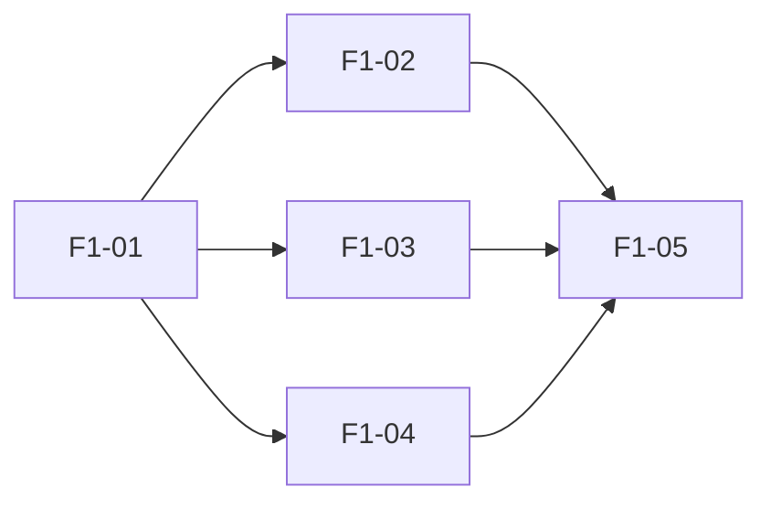

# F1 · Acciones y leyes del mundo

## Objetivo y entregable
Al terminar F1, el núcleo implementa las cuatro acciones restantes (`attack`, `consume`, `reproduce`, `roar`), la muerte inmediata de criatura golpeada hasta vida 0 o menos, la reproducción con condiciones y aborto natural, el rugido disponible el tick siguiente, y se verifican las leyes de fin de tick contra cada acción. Cada acción tiene un escenario mínimo ejecutable desde pruebas unitarias y desde la terminal.

## Estado de partida
F0 completada y en verde:
- `crates/instinct-core/src/actions.rs` implementa `wait`, `move`, `say` y el `Catalog` por nombre (sin cadenas de `if`).
- `crates/instinct-core/src/event.rs` define `Said`, `Died`, `RuntimeError`.
- `crates/instinct-core/src/sim.rs` avanza ticks, resuelve turnos sorteados, aplica fin de tick y drena eventos.
- `crates/instinct-core/src/world.rs` tiene `end_of_tick_creatures` (-1 vida, +1 edad, muertes) y `end_of_tick_terrain_and_objects` (regeneración y objetos agotados).
- `cargo test --workspace`, clippy y fmt están en verde.

## Contratos compartidos
- **Action trait**: `name`, `arity`, `consumes_turn`, `apply(world, creature_id, args) -> Result<ActionResult, Diagnostic>`. Acciones son tipos sin estado registrados en `Catalog` por nombre; no hay cadenas de `if nombre == ...`.
- **ActionResult**: `sleep_turns` (0 = ninguno) y `events: Vec<Event>` que se anexan al log del mundo.
- **Toda acción salvo say consume el turno aunque falle; say no consume turno.**
- **Muerte inmediata**: `attack` o `consume` que deja a una criatura con vida <= 0 la mata en el acto, libera su casilla (queda solo terreno) y emite `Died` con causa `vida` en el mismo tick.
- **Fuera del mapa no hay objetivo**: `attack`, `consume`, `reproduce` con destino fuera del mapa no hacen nada y consumen turno.
- **(0, 0) en `attack`/`consume`**: el objetivo es el terreno bajo la propia criatura (pierde reserva de daño).
- **`reproduce`**: requiere casilla adyacente solo terreno y madre con vida > `health`; cría nace con edad 0, sin variables, programa en `start:`, primer turno en el tick siguiente; cualquier fallo es aborto natural (no hace nada).
- **`roar`**: emite un mensaje disponible el tick siguiente; se almacena como rugido pendiente asociado a tick y posición.
- **Fin de tick**: -1 vida, +1 edad, muerte vida <= 0 o edad >= lifespan, terreno regenera `regen` hasta `resource_max`, objeto reserva <= 0 desaparece, contador +1.
- **Eventos por añadir**: daño aplicado (`Damaged`) y rugido (`Roared`); `Died` causa `vida` ya existe.

## Decisiones de la fase
- `attack` y `consume` comparten la lógica de "golpear casilla adyacente" en una función interna común; se diferencian solo en el heal del atacante.
- `roar` no mata ni daña; solo registra un rugido pendiente que `roars_near` y `last_roar` (F2) leerán. En F1 se emite el evento y se almacena el mensaje por tick y posición.
- La muerte inmediata por golpe se emite durante el turno de la criatura atacante, no al final del tick.
- La disponibilidad del rugido el tick siguiente se gestiona con una cola de rugidos del tick anterior en `sim.rs`.

## Issues
| ID | Título | Depende de | Tamaño | Paralelizable con | Estado |
|----|--------|------------|--------|-------------------|--------|
| F1-01 | attack: daño a criatura, objeto, terreno y casilla propia | — | M | — | done |
| F1-02 | consume: igual que attack más curación del atacante | F1-01 | M | — | done |
| F1-03 | reproduce: cría, condiciones y aborto natural | F1-01 | M | F1-02 | done |
| F1-04 | roar: mensaje disponible el tick siguiente | F1-01 | M | F1-02, F1-03 | done |
| F1-05 | Escenarios E2E uno por acción desde la terminal | F1-01, F1-02, F1-03, F1-04 | M | — | done |

### Orden y dependencias

F1-01 primero porque `attack` y `consume` comparten el código de golpear casilla. F1-02, F1-03 y F1-04 dependen todas de F1-01 (registran acciones en el mismo `Catalog` y reusan su infraestructura) y se ejecutan en cadena tras F1-01. F1-05 integra todo al final.

## Cobertura
| Entregable / criterio de salida de la fase | Issues que lo cubren |
|--------------------------------------------|----------------------|
| `attack` probada contra criatura, objeto, terreno, (0,0) y fuera del mapa | F1-01 |
| `consume` probada con daño + heal, objetivo fuera del mapa no-op | F1-02 |
| `reproduce` con cría edad 0 sin variables y aborto natural | F1-03 |
| `roar` con mensaje disponible el tick siguiente | F1-04 |
| Cada acción con escenario mínimo desde terminal | F1-05 |
| Pruebas de F0 siguen en verde | F1-01 a F1-05 |

## Verificación de salida de la fase
- `cargo test --workspace` → todo en verde.
- `cargo clippy --workspace --all-targets -- -D warnings` → exit 0.
- `cargo fmt --all --check` → exit 0.
- `cargo run -p instinct-cli -- run --root examples --map "Plain with rocks" --seed 1 --ticks 10 --place Walker@0,0` → sigue funcionando sin regresiones (F0).
- [ ] Cada acción de F1 tiene al menos una prueba unitaria con resultado observable.
- [ ] Dos corridas misma semilla dan la misma historia (determinismo).
- [ ] No hay pánicos con objetivos fuera del mapa, casilla propia o objeto agotado.

## Prompt de sesión (copiar/pegar para cada issue)
```text
Implementa el issue `plan/F1-acciones-leyes-mundo/<ID>-<slug>.md`.
Léelo entero antes de tocar código y empieza por su sección "Leer primero".
Ejecuta los comandos de "Verificación" y no lo des por terminado hasta cubrir cada
criterio de aceptación con evidencia. Al acabar: actualiza `status` y rellena
"Notas de implementación". Si el issue contradice el repo o te bloquea, para y repórtalo
en lugar de improvisar.
```

## Registro de ejecución

### Issue 1 — DRY rápido (módulo `actions`)
- **Branch**: `feat/fix-actions-dry-rapido`
- **AC1 (context_helpers)**: `unknown_creature_diagnostic` added to `context_helpers.rs`; `DIAG_WORLD` added to imports. (PASS: `cargo check -p instinct-core` clean)
- **AC2 (shared.rs)**: `unknown_creature_diagnostic` added to re-export block. (PASS: `cargo check -p instinct-core` clean)
- **AC3 (reproduce.rs)**: Removed local `unknown_creature_diagnostic` (lines 29-35) and `creature_context` (lines 46-54); both now imported from `shared`. (PASS: `cargo test -p instinct-core actions::` → 13 unit + 11 reproduce integration tests all pass)
- **AC4 (combat.rs)**: `strike_creature` and `heal_attacker` use `unknown_creature_diagnostic`; `strike_cell` uses `is_out_of_bounds`. (PASS: `cargo clippy -p instinct-core` → no warnings)
- **AC5 (consts.rs)**: No changes needed; `ACTION_ATTACK` is `pub`, rest `pub(super)`, already consistent.
- **Behavior**: No external behavior change. All 50 action tests + full workspace tests pass.
- **Commit**: done

### Issue 2 — DRY: unificar acciones gemelas y registro del catálogo
- **Branch**: `feat/fix-actions-dry-gemas`
- **AC1 (parse.rs)**: Added `parse_strike_args(action, args) -> Result<(i64,i64,i64), Diagnostic>` with 3 tests (ok, bad direction, text damage). (PASS: `cargo test -p instinct-core parse_strike_args` → 3 pass)
- **AC2 (context_helpers.rs)**: Added `event_result(event: Event) -> ActionResult` with 1 test. (PASS: `cargo test -p instinct-core event_result` → 1 pass)
- **AC3 (shared.rs)**: Re-exported `parse_strike_args` and `event_result` in `pub(super) use` blocks. (PASS: `cargo check -p instinct-core` clean)
- **B1 (roar.rs)**: Replaced `action_result(0, vec![Event::Roared{...}])` with `event_result(Event::Roared{...})`. Import `action_result` → `event_result`. (PASS: `cargo check -p instinct-core` clean)
- **B2 (say.rs)**: Replaced `action_result(0, vec![Event::Said{...}])` with `event_result(Event::Said{...})`. Import `action_result` → `event_result`. (PASS: `cargo check -p instinct-core` clean)
- **B3 (attack.rs)**: Replaced `parse_dir_args` + `parse_int_arg` with `parse_strike_args(ACTION_ATTACK, args)?`. Removed `parse_dir_args`, `parse_int_arg`, `ARG_DAMAGE` imports; added `parse_strike_args`. (PASS: `cargo check -p instinct-core` clean)
- **B4 (consume.rs)**: Replaced `parse_dir_args` + `parse_int_arg(damage)` with `parse_strike_args(ACTION_CONSUME, args)?`. Kept `parse_int_arg` for heal. Removed `parse_dir_args`, `ARG_DAMAGE` imports; added `parse_strike_args`. (PASS: `cargo check -p instinct-core` clean)
- **C1 (action_catalog.rs)**: Replaced 7 `let _ = c.register(...)` lines with array + loop + `expect`. Added test `default_registers_all_actions` verifying all 7 names via `is_action_name`. (PASS: `cargo test -p instinct-core default_registers_all_actions` → 1 pass)
- **Verification**: `cargo check -p instinct-core` clean; `cargo test -p instinct-core actions::` → 18 unit + 50 integration tests all pass; `cargo clippy -p instinct-core -- -D warnings` PASS; `cargo fmt -p instinct-core -- --check` PASS.
- **Behavior**: No external behavior change. All 50 action tests + full workspace tests pass.
- **Modified files**: `crates/instinct-core/src/actions/parse.rs`, `crates/instinct-core/src/actions/context_helpers.rs`, `crates/instinct-core/src/actions/shared.rs`, `crates/instinct-core/src/actions/roar.rs`, `crates/instinct-core/src/actions/say.rs`, `crates/instinct-core/src/actions/attack.rs`, `crates/instinct-core/src/actions/consume.rs`, `crates/instinct-core/src/actions/action_catalog.rs`, `plan/F1-acciones-leyes-mundo/PHASE.md`.
- **Commit**: done
