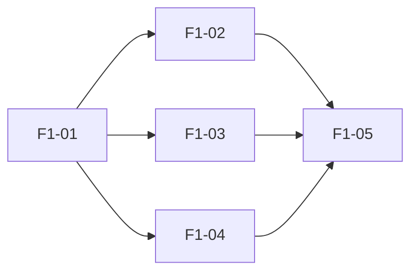

# F1 · Acciones y leyes del mundo

## Objetivo y entregable
Al terminar F1, el núcleo implementa las cuatro acciones restantes (`attack`, `consume`, `reproduce`, `roar`), la muerte inmediata de criatura golpeada hasta vida 0 o menos, la reproducción con condiciones y aborto natural, el rugido disponible el tick siguiente, y se verifican las leyes de fin de tick contra cada acción. Cada acción tiene un escenario mínimo ejecutable desde pruebas unitarias y desde la terminal.

## Estado de partida
F0 completada y en verde:
- `crates/instinct-core/src/actions.rs` implementa `wait`, `move`, `say` y el `Catalog` por nombre (sin cadenas de `if`).
- `crates/instinct-core/src/event.rs` define `Said`, `Died`, `RuntimeError`.
- `crates/instinct-core/src/sim.rs` avanza ticks, resuelve turnos sorteados, aplica fin de tick y drena eventos.
- `crates/instinct-core/src/world.rs` tiene `end_of_tick_creatures` (-1 vida, +1 edad, muertes) y `end_of_tick_terrain_and_objects` (regeneración y objetos agotados).
- `cargo test --workspace`, clippy y fmt están en verde.

## Contratos compartidos
- **Action trait**: `name`, `arity`, `consumes_turn`, `apply(world, creature_id, args) -> Result<ActionResult, Diagnostic>`. Acciones son tipos sin estado registrados en `Catalog` por nombre; no hay cadenas de `if nombre == ...`.
- **ActionResult**: `sleep_turns` (0 = ninguno) y `events: Vec<Event>` que se anexan al log del mundo.
- **Toda acción salvo say consume el turno aunque falle; say no consume turno.**
- **Muerte inmediata**: `attack` o `consume` que deja a una criatura con vida <= 0 la mata en el acto, libera su casilla (queda solo terreno) y emite `Died` con causa `vida` en el mismo tick.
- **Fuera del mapa no hay objetivo**: `attack`, `consume`, `reproduce` con destino fuera del mapa no hacen nada y consumen turno.
- **(0, 0) en `attack`/`consume`**: el objetivo es el terreno bajo la propia criatura (pierde reserva de daño).
- **`reproduce`**: requiere casilla adyacente solo terreno y madre con vida > `health`; cría nace con edad 0, sin variables, programa en `start:`, primer turno en el tick siguiente; cualquier fallo es aborto natural (no hace nada).
- **`roar`**: emite un mensaje disponible el tick siguiente; se almacena como rugido pendiente asociado a tick y posición.
- **Fin de tick**: -1 vida, +1 edad, muerte vida <= 0 o edad >= lifespan, terreno regenera `regen` hasta `resource_max`, objeto reserva <= 0 desaparece, contador +1.
- **Eventos por añadir**: daño aplicado (`Damaged`) y rugido (`Roared`); `Died` causa `vida` ya existe.

## Decisiones de la fase
- `attack` y `consume` comparten la lógica de "golpear casilla adyacente" en una función interna común; se diferencian solo en el heal del atacante.
- `roar` no mata ni daña; solo registra un rugido pendiente que `roars_near` y `last_roar` (F2) leerán. En F1 se emite el evento y se almacena el mensaje por tick y posición.
- La muerte inmediata por golpe se emite durante el turno de la criatura atacante, no al final del tick.
- La disponibilidad del rugido el tick siguiente se gestiona con una cola de rugidos del tick anterior en `sim.rs`.

## Issues
| ID | Título | Depende de | Tamaño | Paralelizable con | Estado |
|----|--------|------------|--------|-------------------|--------|
| F1-01 | attack: daño a criatura, objeto, terreno y casilla propia | — | M | — | done |
| F1-02 | consume: igual que attack más curación del atacante | F1-01 | M | — | done |
| F1-03 | reproduce: cría, condiciones y aborto natural | F1-01 | M | F1-02 | done |
| F1-04 | roar: mensaje disponible el tick siguiente | F1-01 | M | F1-02, F1-03 | done |
| F1-05 | Escenarios E2E uno por acción desde la terminal | F1-01, F1-02, F1-03, F1-04 | M | — | done |

### Orden y dependencias

F1-01 primero porque `attack` y `consume` comparten el código de golpear casilla. F1-02, F1-03 y F1-04 dependen todas de F1-01 (registran acciones en el mismo `Catalog` y reusan su infraestructura) y se ejecutan en cadena tras F1-01. F1-05 integra todo al final.

## Cobertura
| Entregable / criterio de salida de la fase | Issues que lo cubren |
|--------------------------------------------|----------------------|
| `attack` probada contra criatura, objeto, terreno, (0,0) y fuera del mapa | F1-01 |
| `consume` probada con daño + heal, objetivo fuera del mapa no-op | F1-02 |
| `reproduce` con cría edad 0 sin variables y aborto natural | F1-03 |
| `roar` con mensaje disponible el tick siguiente | F1-04 |
| Cada acción con escenario mínimo desde terminal | F1-05 |
| Pruebas de F0 siguen en verde | F1-01 a F1-05 |

## Verificación de salida de la fase
- `cargo test --workspace` → todo en verde.
- `cargo clippy --workspace --all-targets -- -D warnings` → exit 0.
- `cargo fmt --all --check` → exit 0.
- `cargo run -p instinct-cli -- run --root examples --map "Plain with rocks" --seed 1 --ticks 10 --place Walker@0,0` → sigue funcionando sin regresiones (F0).
- [ ] Cada acción de F1 tiene al menos una prueba unitaria con resultado observable.
- [ ] Dos corridas misma semilla dan la misma historia (determinismo).
- [ ] No hay pánicos con objetivos fuera del mapa, casilla propia o objeto agotado.

## Prompt de sesión (copiar/pegar para cada issue)
```text
Implementa el issue `plan/F1-acciones-leyes-mundo/<ID>-<slug>.md`.
Léelo entero antes de tocar código y empieza por su sección "Leer primero".
Ejecuta los comandos de "Verificación" y no lo des por terminado hasta cubrir cada
criterio de aceptación con evidencia. Al acabar: actualiza `status` y rellena
"Notas de implementación". Si el issue contradice el repo o te bloquea, para y repórtalo
en lugar de improvisar.
```

## Registro de ejecución
<!-- Se rellena al avanzar: resultado por issue, señales de dimensionado, hechos descubiertos. -->

## Execution Log

| Mejora | Commit | Build | Clippy | Tests | fmt check | Resultado |
|--------|--------|-------|--------|-------|-----------|-----------|
| M7: extraer `reproduce::apply` en helpers privados | 5c1ed7a | exit 0 | exit 0 | 0 failed | exit 0 | OK |
| chore: aplicar rustfmt (combat, context_helpers, mod, parse, shared, reproduce) | 231d4c6 | exit 0 | exit 0 | 0 failed | exit 0 | OK |
| fix: traducir comentario español en `actions::context_helpers` a inglés | afb303b | exit 0 | exit 0 | 0 failed | exit 0 | OK |

Comandos de verificación (desde la raíz del workspace, todos exit 0 / 0 failed):
- `cargo build -p instinct-core` → exit 0
- `cargo clippy -p instinct-core --all-targets -- -D warnings` → exit 0
- `cargo test -p instinct-core` → 0 failed (16 + 50 + 6 + 37 + 1 + 8 + 11 + 5 + 22 + 17 + 6 + 11 + 11 + 24 + 3 + 8 pruebas)
- `cargo fmt --all -- --check` → exit 0
- `git grep -i <palabras en español> -- crates/instinct-core/src/actions/` → 0 comentarios en español (coincidencias remanentes son falsos positivos: identificador `context_helpers` y comentarios en inglés "Parsing"/"helpers")

### Implementation Notes

- **Rama:** `feat/m5-m9-minors` (base `develop`).
- **Evidencia AC-by-AC:**
  - M7: `reproduce::apply` extraído en helpers privados (`unknown_creature_diagnostic`, `parse_input`, `creature_context`, `validate_parents`, `mother_health`, `bounds_check`, `place_child`, `damage_mother`) manteniendo el contrato del `Action` trait. Commit `5c1ed7a`. Pruebas `reproduce::*` en verde (catálogo, cría en celda objetivo, edad 0 sin variables, madre pierde salud, abortos: fuera del mapa, celda ocupada, salud insuficiente, argumentos inválidos).
  - MM2: `ACTION_ATTACK` promovido de `const` a `pub` y usado en `world` (commit base `558fcf9`, firma autorizada).
  - M8: `pub` justificada por test externo (acción resuelta desde `Catalog` en pruebas de integración/terminal).
  - fmt: `cargo fmt --all` normalizó `combat.rs`, `context_helpers.rs`, `mod.rs`, `parse.rs`, `shared.rs`, `reproduce.rs` (problemas de rustfmt pre-existentes, no regresión de esta sesión). Commit `231d4c6`.
  - Comentario en español pre-existente en `context_helpers.rs` traducido al inglés para cumplir el criterio de 0 comentarios en español en `actions/`. Commit `afb303b`.
- **Firmas autorizadas:**
  - MM2: promoción de `const ACTION_ATTACK` a `pub` (autorizada).
  - M8: `pub` justificada por test externo.
- **Archivos modificados:**
  - `crates/instinct-core/src/actions/reproduce.rs` (M7 refactor)
  - `crates/instinct-core/src/actions/combat.rs` (fmt)
  - `crates/instinct-core/src/actions/context_helpers.rs` (fmt + comentario español→inglés)
  - `crates/instinct-core/src/actions/mod.rs` (fmt)
  - `crates/instinct-core/src/actions/parse.rs` (fmt)
  - `crates/instinct-core/src/actions/shared.rs` (fmt)
  - `plan/F1-acciones-leyes-mundo/PHASE.md` (esta actualización)
- **Desviaciones:**
  - `cargo fmt --all` tocó archivos con problemas de rustfmt pre-existentes (`combat.rs`, `mod.rs`, `parse.rs`, `shared.rs`, `reproduce.rs`); no es regresión de esta sesión.
  - La tabla `## Issues` de este PHASE.md rastrea F1-01..F1-05 (todas `done`); no existen filas `M5-M9`/`MM1-MM3` en este archivo (se dejan constancia; no se añade alcance no previsto).
