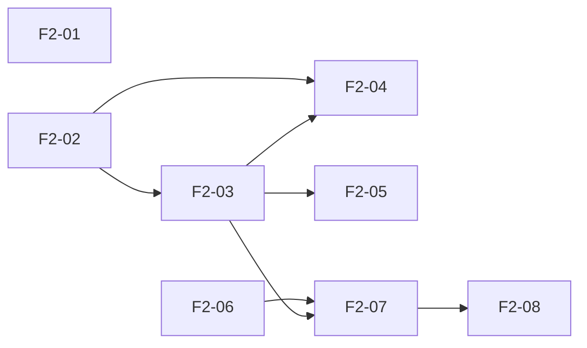

# F2 · Estabilidad: bugs, contratos y pruebas

## Objetivo y entregable

Al terminar F2, ninguno de los problemas de `docs/PROBLEMAS_Y_SOLUCIONES.md` sigue latente en el
código: los que no se resuelven con patrones de diseño (correcciones, una feature y pruebas) y
también los que sí, cuando arreglan comportamiento incorrecto (un `panic` posible, un error
descartado, un fallo silencioso) o cuando la siguiente fase los necesita como contrato. Los
patrones que solo reestructuran código correcto quedan para F4.

Entregable observable: una suite que cubre los huecos de prueba de las seis partes (lexer, parser,
intérprete, mundo, núcleo, CLI), errores uniformes con archivo y línea en toda la pila, y una CLI
que rechaza en lugar de ignorar o envolver. El comportamiento correcto de F0 y F1 no cambia: los
escenarios E2E siguen dando la misma salida para la misma semilla.

## Estado de partida

F1 completada y en verde (150 tests, clippy y fmt en verde):

- `crates/instinct-core/src/lexer.rs` — `lex(text, line)` por línea, `LexError { message, line }`
  sin archivo, textos sin escapes, identificadores ASCII, fail-fast.
- `crates/instinct-core/src/expr.rs` — `Parser` de descenso recursivo con tres `unwrap()` sobre
  `advance()` (líneas 269, 287 y 302), `ParseError` ya lleva archivo y línea y `expr::parse`
  convierte a `Diagnostic`.
- `crates/instinct-core/src/compile.rs` — acumula diagnósticos sin abortar; exige la etiqueta
  `start` (línea 357); `parse_action_call` descarta errores de argumentos con `.ok()?` (líneas
  535-542); `looks_like_assignment` (líneas 373-394) acepta nombres que empiezan por dígito.
- `crates/instinct-core/src/interp.rs` — `execute_turn` reinicia en 0 con `unwrap_or(0)` si no
  encuentra `start` (línea 194) y cuenta `lines_executed` antes de comprobar `LINE_LIMIT`
  (líneas 167-178).
- `crates/instinct-core/src/world.rs` — `draw` usa `expect` (línea 580) e indexa catálogos sin
  comprobar (líneas 583-584); `end_of_tick_creatures` hace `health - 1` y `age + 1` sin `checked`
  (líneas 501-502, 522-523) y consulta `dead_ids.contains` dentro de un bucle (línea 521).
- `crates/instinct-core/src/actions.rs` — `Move::apply` convierte coordenadas a `usize` sin
  comprobar el signo (líneas 402-415).
- `crates/instinct-core/src/sim.rs` — `Simulation` guarda sus propias copias de `terrains` y
  `objects` (constructor, línea 27), distintas de las de `World`.
- `crates/instinct-cli/src/main.rs` — `parse_run` ignora flags desconocidos, `--ticks` se convierte
  a `u64` sin validar el signo, `--root` toma `examples` por defecto sin comprobar que exista.
- Pruebas: `crates/instinct-core/tests/{lexer,expr,compile,interp,world,sim,value,event}_tests.rs`
  y `crates/instinct-cli/tests/{cli_run,cli_check,cli_usage}.rs`; no existe `program_tests.rs`.

## Contratos compartidos

Salvo que un issue diga lo contrario, estos contratos son de cumplimiento obligatorio:

- **Diagnóstico único**: `Diagnostic { file, line, message }` es el único tipo de error que cruza
  los límites de módulo. Los tipos propios (`LexError`, `ParseError`) solo sobreviven si el issue
  que los toca lo declara y añaden la conversión explícita.
- **Cero `unwrap`/`expect` sobre datos de usuario o fichero**, y cero índice fuera de rango:
  fuera del mapa es no-op, entrada inválida es error de ejecución o de compilación, nunca panic.
- **Cambios de firma**: solo los que esta fase autoriza, y siempre con las pruebas y los sitios de
  llamada actualizados en el mismo issue. Los autorizados son: `lex`, `LexError`, `World::draw`,
  `end_of_tick_terrain_and_objects`, `Simulation::new` y lo que de ellos dependa.
- **Comportamiento observable**: no cambia salvo donde un AC lo indica expresamente. Toda prueba
  que falle por un cambio de contrato esperado se ajusta en el mismo issue y se cita en sus notas.
- **Orden de issues**: lo que cambia comportamiento o contrato va antes de lo que solo añade
  pruebas, para no escribir pruebas contra un contrato que se va a mover.
- **Puerta de calidad**: cada issue termina con `cargo test --workspace`,
  `cargo clippy --workspace --all-targets -- -D warnings` y `cargo fmt --all --check` en verde.

## Decisiones de la fase

1. **El lenguaje es ASCII.** Los identificadores y los dígitos siguen con `is_ascii_*`; un
   carácter no ASCII es error `unknown character`. No se abre Unicode en esta fase (problema L5).
2. **`lex` conoce el archivo.** Se le pasa `file` y `LexError` lleva archivo, línea y mensaje, con
   conversión a `Diagnostic`. Es la unificación mínima que elimina el borde improvisado de
   `expr::parse` hoy (problema L1).
3. **Fail-fast se mantiene** en lexer y parser (primer error detiene la línea); la acumulación de
   diagnósticos de `compile` no se toca. Problemas L6 y P6 quedan cerrados por contrato, no por
   código nuevo.
4. **Un solo dueño de los catálogos: `World`.** `Simulation` consume los catálogos al construir el
   mundo y deja de guardar copias, así que el daño y la regeneración leen y escriben la misma
   reserva (problema W2).
5. **`World::draw` devuelve `Result`** y valida contra sus propios catálogos; con la decisión 4 ya
   no necesita recibirlos como argumentos (problema W1).
6. **El límite de líneas cuenta líneas ejecutadas**, no intentos: como máximo 100 por turno y `pc`
   siempre en una línea válida (problemas I2 e I4).
7. **Un valor de header inválido produce exactamente un diagnóstico** con la línea del valor; el
   parseo numérico se hace una sola vez (problema P5). Nota de auditoría: la evidencia del
   documento hablaba de dos diagnósticos y el código actual emite uno; el AC fija el contrato para
   que no se rompa en ninguna dirección.

## Issues

| ID | Título | Depende de | Tamaño | Paralelizable con | Problemas que cubre | Estado |
|----|--------|------------|--------|-------------------|---------------------|--------|
| F2-01 | Lexer: contrato de líneas, escapes en textos e identificadores ASCII | — | M | F2-06 | L2, L3, L4, L5, L6 | done |
| F2-02 | Parser: argumentos propagados, asignación robusta y operadores sin comillas | — | M | F2-01, F2-06 | P2, P3, P4, P5, P7 (parcial) | done |
| F2-03 | Errores unificados y cero `unwrap`/`expect` sobre datos de entrada | F2-02 | M | F2-06 | L1, P1, W1, I1, A1, A2, A3 | done |
| F2-04 | Etiquetas deterministas y pruebas del núcleo de tipos | F2-02, F2-03 | M | F2-05, F2-06 | A4, A5, P7 (resto) | done |
| F2-05 | Intérprete: `pc` válido y límite de líneas sin off-by-one | F2-03 | M | F2-04, F2-06 | I2, I4, I5 | done |
| F2-06 | Mundo y tick: aritmética comprobada y coordenadas sin envoltura | — | M | — | W3, W4, W6 | done |
| F2-07 | Catálogos de terrenos y objetos con un solo dueño | F2-03, F2-06 | L | F2-04, F2-05 | W2 | todo |
| F2-08 | CLI: validación de argumentos, separación de flujos y pruebas | F2-03, F2-07 | L | — | C1, C2, C3, C5, C4 | todo |

### Orden y dependencias



- **F2-02 antes que F2-03**: los dos editan la ruta de parseo (`expr.rs`/`compile.rs`); hacerlos en
  cadena evita que dos sesiones se pisen en el mismo sitio.
- **F2-03 antes que F2-04 y F2-05**: cambia el contrato de error de `lex`, `execute_turn` y
  `draw`; sus pruebas se escriben contra el contrato definitivo.
- **F2-06 antes que F2-07**: las pruebas de robustez de `World`/`Simulation` (W6) son la red de
  seguridad del cambio de dueño de los catálogos.
- **F2-07 antes que F2-08**: la CLI consume `draw` y la API de `Simulation`; si el dueño cambia,
  que cambie una sola vez.
- **F2-01 y F2-06** son independientes y pueden ir primero o en paralelo con cualquiera.

## Cobertura

| Problema de `docs/PROBLEMAS_Y_SOLUCIONES.md` | Issue | Tipo de resolución |
|----------------------------------------------|-------|--------------------|
| L1 · LexError sin archivo ni `Diagnostic` | F2-03 | Patrón: Error Chain |
| L2 · `\r\n` cuenta dos saltos | F2-01 | Corrección |
| L3 · textos sin escapes | F2-01 | Feature |
| L4 · cobertura débil del lexer | F2-01 | Pruebas |
| L5 · solo ASCII | F2-01 | Corrección (decisión documentada) |
| L6 · sin recuperación de errores | F2-01 | Corrección (contrato fail-fast) |
| P1 · `unwrap` en `Parser::expect`/`advance` | F2-03 | Patrón: Result idiomático |
| P2 · errores de args descartados | F2-02 | Corrección |
| P3 · `looks_like_assignment` frágil | F2-02 | Corrección |
| P4 · `operator_text` con comillas | F2-02 | Corrección |
| P5 · validación de header duplicada | F2-02 | Corrección |
| P6 · parser sin recuperación | F2-02 | Corrección (contrato fail-fast, sin código) |
| P7 · cobertura de `compile` | F2-02, F2-04 | Pruebas |
| I1 · `unwrap_or(0)` al falta `start` | F2-03 | Patrón: Result idiomático |
| I2 · off-by-one de `LINE_LIMIT` | F2-05 | Corrección |
| I3 · `sleep_turns` externo | F4-02 | Patrón: State |
| I4 · `pc` fuera de rango | F2-05 | Corrección |
| I5 · cobertura del intérprete | F2-05 | Pruebas |
| I6 · intérprete sin eventos internos | F4-01 | Patrón: Observer / bus |
| W1 · `expect` en `World::draw` | F2-03 | Patrón: Result idiomático |
| W2 · catálogos desincronizados | F2-07 | Patrón: Puertos y adaptadores |
| W3 · cast a `usize` sin signo | F2-06 | Corrección |
| W4 · aritmética sin `checked` en fin de tick | F2-06 | Corrección |
| W5 · búsqueda lineal y `dead_ids` O(n²) | F4-04 | Patrón: ECS ligero |
| W6 · cobertura de mundo y simulación | F2-06 | Pruebas |
| A1 · `unwrap_or(0)` visto desde el núcleo | F2-03 | Igual que I1 |
| A2 · `unwrap` en parser | F2-03 | Igual que P1 |
| A3 · `expect` en `draw` | F2-03 | Igual que W1 |
| A4 · `labels` como `HashMap` | F2-04 | Corrección |
| A5 · cobertura del núcleo | F2-04 | Pruebas |
| C1 · flags desconocidos ignorados | F2-08 | Patrón: Command |
| C2 · `--ticks` sin validar | F2-08 | Patrón: Builder |
| C3 · `--root` sin validar | F2-08 | Patrón: Builder |
| C4 · cobertura de la CLI | F2-08 | Pruebas |
| C5 · mezcla de streams | F2-08 | Patrón: separación de flujos |

De `docs/PATRONES_DISENO_ARQUITECTURA.md` entran en F2 solo Puertos y adaptadores en su versión
mínima (un solo dueño de los catálogos), Command y Builder para la CLI, y la separación de flujos.
El resto (capas, puertos formales, Observer como bus, ECS, Flyweight, State, Memento, Visitor,
PRNG inyectable, validación acumulativa) es F4 o F5 según indica la tabla.

## Verificación de salida de la fase

- `cargo test --workspace` → todo en verde (sin regresiones de F0 y F1 salvo las ajustadas y
  citadas en las notas de cada issue).
- `cargo clippy --workspace --all-targets -- -D warnings` → exit 0.
- `cargo fmt --all --check` → exit 0.
- `cargo run -p instinct-cli -- run --root examples --map "Plain with rocks" --seed 1 --ticks 10 --place Walker@0,0` → exit 0, misma salida que en F1 salvo el cambio de flujos de F2-08.
- [ ] Cero `unwrap`/`expect`/`panic!` sobre datos de usuario o fichero en `crates/instinct-core/src` y `crates/instinct-cli/src`.
- [ ] Cada problema de la tabla de cobertura tiene issue y, si es de comportamiento, prueba.
- [ ] Dos corridas con la misma semilla dan la misma historia.

## Prompt de sesión (copiar/pegar para cada issue)

```text
Implementa el issue `plan/F2-estabilidad/<ID>-<slug>.md`.
Léelo entero antes de tocar código y empieza por su sección "Leer primero".
Ejecuta los comandos de "Verificación" y no lo des por terminado hasta cubrir cada
criterio de aceptación con evidencia. Al acabar: actualiza `status` y rellena
"Notas de implementación". Si el issue contradice el repo o te bloquea, para y repórtalo
en lugar de improvisar.
```

## Registro de ejecución

<!-- Se rellena al avanzar: resultado por issue, señales de dimensionado, hechos descubiertos. -->
