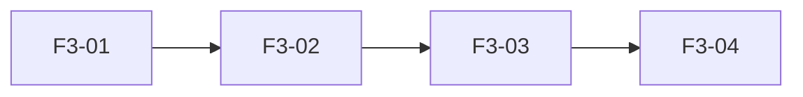

# F3 · Percepciones, funciones y texto

## Objetivo y entregable

Completar el catálogo del lenguaje: las 31 percepciones del enunciado (10 sobre sí misma, 7 sobre
el mundo, 14 sobre lo cercano), las funciones reservadas `see(x, y)` y `name(x, y)`, las cinco
constantes (`NONE`, `GROUND`, `OBJECT`, `ALLY`, `ENEMY`) y las operaciones con texto.

Entregable observable: los cuatro ejemplos del anexo (Hobbit, Ent, Dwarf y Uruk) compilan sin
diagnósticos y corren en la terminal mostrando los comportamientos que el anexo describe, con dos
corridas con la misma semilla dando exactamente la misma salida.

## Estado de partida

Verificado sobre el repo tras el cierre de F2 (8/8 issues, veredicto [APROBADO]; `cargo test
--workspace`, clippy y fmt en verde):

- `crates/instinct-core/src/perception.rs` — trait `Perception` (`name`, `read`, `clone_box`),
  `PerceptionCatalog` y `CreatureView` con solo siete accesores (`health`, `age`, `lifespan`, `x`,
  `y`, `tick`, `random`); `PerceptionCatalog::default()` registra esas siete.
- `crates/instinct-core/src/actions.rs` — trait `Action`, `Catalog` (acciones + percepciones) con
  `resolve`, `resolve_perception`, `is_action_name`, `is_perception_name`; `Catalog::default()`
  registra las siete acciones y las siete percepciones.
- `crates/instinct-core/src/expr.rs` — trait `EvalContext` con un único método (`resolve`); nodos
  `LiteralInt`, `LiteralText`, `Name`, `Unary`, `Binary`; un nombre seguido de `(` es hoy error
  fijo `unknown function`; `parse(text, line, file)` no recibe catálogos.
- `crates/instinct-core/src/compile.rs` — tres sitios llaman a `expr::parse` (líneas 295, 543 y
  606); `parse_assignment` rechaza palabras reservadas, nombres de percepción y de acción.
- `crates/instinct-core/src/world.rs` — `CreatureSnapshot` implementa `CreatureView` con los siete
  accesores; `CreatureContext::resolve` resuelve primero percepciones y después variables y
  construye la instantánea en cada llamada; rugidos en `roars_current`/`roars_previous` con
  `add_roar`, `previous_roars`, `rotate_roars`; `set_variable` rechaza nombres de acción y de
  percepción.
- `crates/instinct-core/src/sim.rs` — `step_tick` rota los rugidos al final del tick.
- `crates/instinct-core/src/value.rs` — semántica de texto ya resuelta: `==`/`!=` entre textos,
  error de tipo en aritmética y comparaciones de orden, `and`/`or`/`not` aceptan cualquier
  combinación, división y resto con semántica de Python y aritmética comprobada.
- `crates/instinct-core/src/actions.rs` — `Roar` guarda el rugido; texto donde se espera número es
  error de ejecución (`wait`, `move`, `attack`, `consume`, `reproduce`); `say`/`roar` aceptan
  cualquier valor.
- Dobles de prueba que implementan `CreatureView`: `FixedView` en las pruebas de
  `src/perception.rs` y `EmptyView` en `crates/instinct-core/tests/perception_tests.rs`.
- `crates/instinct-cli/src/main.rs` — `run` (con `--root`, `--map`, `--seed`, `--ticks`, `--every`,
  `--place Especie@x,y`) y `check <archivo.ins>`; los escenarios E2E de terminal están en
  `crates/instinct-cli/tests/cli_run.rs` con el ayudante `examples_dir()`.
- `examples/` — `creatures/` con nueve criaturas de fases anteriores, `maps/plain.map` (7x20),
  `terrains/grass.te`, `objects/rock.ob`. Ninguno de los cuatro ejemplos del anexo existe aún.

## Contratos compartidos

Los issues los referencian; no los reexplican.

- **`CreatureView` crece, no se sustituye.** El trait de `perception.rs` es el único contrato de
  lectura que ven las percepciones y las funciones. F3 le añade accesores agrupados, uno por
  grupo de percepciones: los diez escalares de "sí misma" y "mundo" (`vision`, `species_name`,
  `faction_name`, `terrain_here`, `reserve_here`, `width`, `height`, `total_creatures`,
  `total_allies`, `total_enemies`), el grupo de cercanía con un único método (`nearby`) y las dos
  funciones (`see`, `name`). Cada percepción lee exactamente un accesoro; ningún tipo de
  percepción contiene lógica de mundo.
- **Un solo recorrido para lo cercano.** `nearby()` devuelve una estructura con los tres conteos,
  los tres "más cercanos" y los dos datos de rugido. Tipos nuevos en `perception.rs`: `Nearest`
  (`dist`, `dx`, `dy`) y `Nearby` (`allies`, `enemies`, `objects`, `ally`, `enemy`, `object`,
  `roars`, `last_roar`). El recorrido es fijo y vive en `world.rs`: criaturas en orden de
  identificador ascendente (el orden del vector `creatures`), rejilla por filas ascendentes y, en
  cada fila, por columnas ascendentes, y rugidos en el orden del vector. Entre varios candidatos a
  la misma distancia gana el primero de ese recorrido.
- **Distancia y radio.** La distancia entre casillas es la de Chebyshev (`max(|dx|, |dy|)`), así
  que las ocho vecinas están a distancia 1. "Dentro del radio de visión" es distancia menor o
  igual que `vision`. La propia casilla queda fuera de los conteos y de los "más cercanos".
- **Ninguno visible.** `enemy_dist` (y sus equivalentes de aliado y objeto) vale -1 y las
  direcciones 0 cuando no hay objetivo dentro del radio.
- **Rugidos.** `roars_near` cuenta los rugidos de otras criaturas emitidos en el tick anterior
  cuyo emisor estaba dentro del radio; `last_roar` es el texto del último de ellos, o el texto
  vacío si no oyó ninguno. Una criatura no se oye a sí misma, así que `Roar` pasa a guardar el
  identificador del emisor.
- **Funciones reservadas, no nombres sueltos.** Nuevo módulo
  `crates/instinct-core/src/functions.rs` con el trait `Function` (`name`, `arity`, `call`,
  `clone_box`) y su catálogo por nombre, siguiendo el patrón de `Action`/`Catalog`. `see` y `name`
  se registran en el catálogo por defecto. El compilador resuelve el nombre y valida la aridad al
  compilar: nombre desconocido o aridad distinta son error de compilación con archivo y línea. El
  nodo `Call` del AST guarda la función ya resuelta (igual que `Line::Action` guarda la acción), de
  modo que la evaluación no compara nombres.
- **`EvalContext` expone la vista.** El trait gana `view()`, que devuelve la instantánea de la
  criatura que evalúa, para que `Call` pueda invocar la función con la misma vista que usan las
  percepciones. `CreatureContext` guarda la instantánea en lugar de construirla en cada `resolve`.
  Contextos de prueba sin vista devuelven que no la tienen; una llamada evaluada sin vista es
  error de ejecución.
- **Constantes en el catálogo único.** Las cinco constantes son pares nombre-valor del `Catalog`
  de `actions.rs`, con `resolve_constant` e `is_constant_name`, registradas en el catálogo por
  defecto. El orden de resolución de un nombre en expresión es: percepción, constante, variable.
  Ninguna constante se puede usar como destino de asignación.
- **Doble registro en los catálogos por defecto.** Toda percepción, función y constante nuevos se
  registran a la vez en `Catalog::default()` y en el catálogo por defecto de su módulo. Un nombre
  registrado en un sitio y no en el otro es un fallo del issue.
- **Asignación rechazada por catálogo.** `compile` rechaza asignar a palabras reservadas,
  percepciones, acciones, funciones y constantes; `World::set_variable` hace la misma comprobación
  para quienes escriban por la API.
- **Operaciones con texto (ya vigentes, se protegen con pruebas).** El texto solo admite `==` y
  `!=`; aritmética y comparaciones de orden con texto son error de ejecución; `and`/`or`/`not`
  aceptan cualquier combinación; las cinco acciones numéricas rechazan texto donde esperan número;
  `say` y `roar` aceptan cualquier valor y muestran el número como texto.

## Cambios de firma autorizados en esta fase

| Firma | Antes | Después de F3 | Por qué |
|-------|-------|---------------|---------|
| `CreatureView` | 7 accesores | 7 + 10 escalares + `nearby` + `see` + `name` | Es el contrato de lectura de las percepciones y funciones nuevas |
| `expr::parse` | `parse(text, line, file)` | `parse` recibe además el catálogo de funciones | Nombre de función desconocido y aridad son errores de compilación |
| `EvalContext` | solo `resolve` | `resolve` + `view` | Las funciones necesitan la vista de la criatura, no nombres |
| `Roar` y `add_roar` | sin emisor | con identificador del emisor | Una criatura no se oye a sí misma |
| `World::set_variable` | rechaza acción/percepción | rechaza también función y constante | Coherencia con `compile` |

Propagación obligatoria en el mismo issue que cambia la firma: los dobles de prueba
(`FixedView` en `src/perception.rs`, `EmptyView` en `tests/perception_tests.rs`), los sitios de
`expr::parse` (`compile.rs` y `tests/perception_tests.rs`) y las pruebas que afirman hoy
`unknown function` para cualquier llamada. Ninguna aserción se suaviza: se ajusta al contrato
nuevo y se cita en las notas del issue.

## Decisiones de la fase

1. **El radio es de Chebyshev y la propia casilla no cuenta** — porque el enunciado define la
   distancia como el mayor de los dos desplazamientos y excluye a la propia criatura de los
   totales; extender eso a los conteos de cercanía es lo único coherente con `total_allies`.
2. **Un único recorrido fijo, sinorden dependiente del azar** — porque el enunciado pide que el
   "más cercano" sea estable mientras la situación no cambie; el recorrido por identificadores y
   por filas y columnas lo garantiza sin ordenar por semilla.
3. **Las percepciones se resuelven al leerse, no se refrescan en bloque al empezar el turno** —
   porque `random` debe consumir una extracción cada vez que aparece, y el mundo solo cambia por
   acciones que terminan el turno (salvo `say`, que no altera nada que lean las percepciones), de
   modo que el resultado observable es el mismo con un coste menor.
4. **`nearby()` recalcula en cada lectura** — catorce recorridos por turno sobre un radio pequeño
   es despreciable, y evita un estado cacaché que habría que invalidar; F9 mide si hace falta.
5. **Las funciones se resuelven al compilar y se guardan resueltas en el AST** — es la decisión de
   catálogo ya tomada para las acciones, y hace que "nombre de función desconocido" y "aritidad
   distinta" sean errores de compilación como pide la sección 2.8.
6. **Las constantes viven en el catálogo único, no como percepciones** — no son de sólo lectura
   por vista de criatura sino valores fijos del lenguaje, y compartirlas en `Catalog` mantiene un
   solo dueño de nombres reservados (lección de F2-07).
7. **Las ambigüedades nuevas se anotan en `docs/ambiguedades.md`** — filas A14 a A17: rugidos
   propios excluidos y "último" como último emitido; empate del más cercano; casilla propia fuera
   de los conteos; argumentos de texto en `see`/`name` como error de ejecución.

## Issues

| ID | Título | Depende de | Tamaño | Paralelizable con | Estado |
|----|--------|------------|--------|-------------------|--------|
| F3-01 | Percepciones sobre sí misma y sobre el mundo | — | M | — | done |
| F3-02 | Percepciones de cercanía: conteos, más cercano estable y rugidos | F3-01 | L | — | done |
| F3-03 | `see` y `name` con las cinco constantes | F3-02 | L | — | done |
| F3-04 | Los cuatro ejemplos del anexo | F3-03 | M | — | todo |

### Orden y dependencias



- **En cadena, aunque F3-01 y F3-03 no compartan comportamiento**: los tres primeros editan
  `perception.rs` (el trait crece), `world.rs` (la instantánea y las consultas) y `actions.rs`
  (los registros). Encadenarlos evita que dos sesiones se pisen en el mismo sitio; la cadena es de
  solapamiento de archivos, no de dependencia semántica.
- **F3-02 antes que F3-03** porque `nearby` fija la estructura `Nearby`/`Nearest` y la regla de
  recorrido que `see`/`name` reutilizan para el radio y los empates.
- **F3-04 al final** porque es la integración: necesita las 31 percepciones, las dos funciones y
  las constantes para que los cuatro archivos del anexo compilen.

## Cobertura

| Entregable / criterio de salida de la fase | Issues que lo cubren |
|--------------------------------------------|----------------------|
| Catálogo completo de percepciones (31 nombres) | F3-01, F3-02 |
| `see(x, y)` y `name(x, y)` | F3-03 |
| Las cinco constantes | F3-03 |
| Operaciones con texto (comparaciones, errores de tipo, número como texto) | F3-01, F3-02, F3-03 |
| Los cuatro ejemplos del anexo compilan y ejecutan | F3-04 |
| Resolver las percepciones y funciones sin cadena de `if` por nombre | F3-01, F3-02, F3-03 |
| Prueba por percepción y por función | F3-01, F3-02, F3-03 |
| Determinismo: misma semilla, misma historia | F3-02, F3-04 |

## Verificación de salida de la fase

- `cargo test --workspace` → todo en verde.
- `cargo clippy --workspace --all-targets -- -D warnings` → exit 0.
- `cargo fmt --all --check` → exit 0.
- `cargo run -p instinct-cli -- check examples/creatures/hobbit.ins` (y `ent`, `dwarf`, `uruk`) →
  imprime `OK` y exit 0.
- `cargo run -p instinct-cli -- run --root examples --map "Plain with rocks" --seed 7 --ticks 30
  --place Dwarf@0,1 --place Ent@5,5 --place Hobbit@10,10 --place Uruk@15,3` → exit 0, stderr vacío,
  y dos ejecuciones con la misma semilla producen la misma salida.
- [ ] Las 31 percepciones y las 2 funciones del enunciado resuelven por catálogo, sin cadena de
      `if` por nombre.
- [ ] Cero `unwrap`/`expect`/`panic!` nuevos sobre datos de usuario o fichero en
      `crates/instinct-core/src` y `crates/instinct-cli/src`.
- [ ] Las ambigüedades A14 a A17 quedan anotadas en `docs/ambiguedades.md`.
- [ ] Los escenarios E2E de F0, F1 y F2 siguen dando la misma salida para la misma semilla.
- [ ] Sesión de verificación independiente: un agente distinto del que implementó comprueba cada
      criterio de aceptación contra el código y los comandos, y emita su veredicto.

## Prompt de sesión (copiar/pegar para cada issue)

```text
Implementa el issue `plan/F3-percepciones-funciones-texto/<ID>-<slug>.md`.
Léelo entero antes de tocar código y empieza por su sección "Leer primero".
Ejecuta los comandos de "Verificación" y no lo des por terminado hasta cubrir cada
criterio de aceptación con evidencia. Al acabar: actualiza `status` y rellena
"Notas de implementación". Si el issue contradice el repo o te bloquea, para y repórtalo
en lugar de improvisar.
```

## Registro de ejecución

<!-- Se rellena al avanzar: resultado por issue, señales de dimensionado (¿grande/pequeño?),
hechos descubiertos que cambian el plan. Lo consume el Modo Revisión. -->
